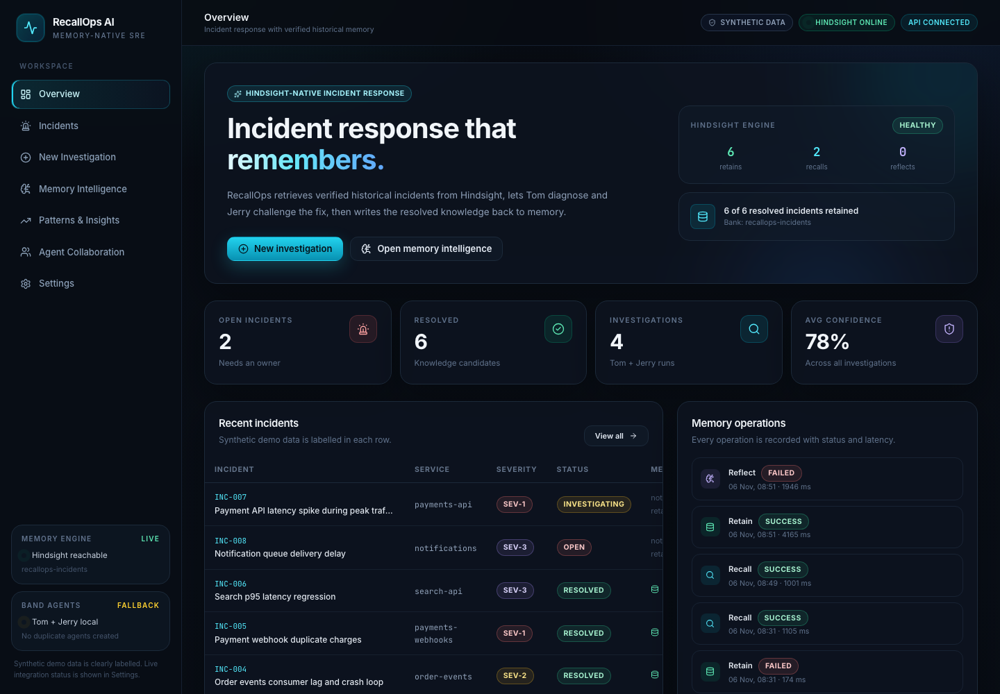
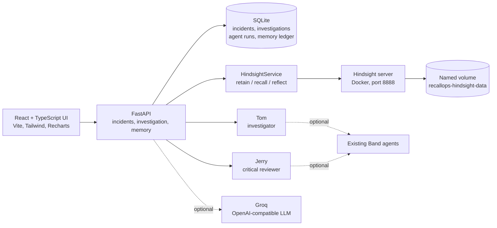

# RecallOps AI

**Incident response that remembers.**

RecallOps is a focused SRE incident-response workspace where every resolved incident becomes
structured Hindsight memory. When a new incident arrives, Tom investigates using verified
historical context, Jerry independently challenges the diagnosis, and the final runbook can be
written back to memory for the next responder.

The product makes the memory advantage visible: the same incident can be investigated with
memory ON and memory OFF, and the two runs are compared side by side.



## Why Hindsight is central

Hindsight is not a chat-history sidebar. It is the system of record for operational knowledge:

- **Retain** — resolved incidents are stored with symptoms, root cause, resolution summary,
  resolution steps, service tags and synthetic-data provenance.
- **Recall** — a new incident triggers a real Hindsight query. Retrieved memories are rendered as
  evidence with their source and score, not hidden inside a prompt.
- **Reflect** — Hindsight can synthesize a cross-incident runbook. It is wired to the real SDK and
  honestly reports free-tier quota failures.
- **Memory ledger** — every retain, recall and reflect call is persisted with status, latency,
  request summary, response summary and error text.

When Hindsight is unavailable, the UI says so. It never presents a deterministic fallback as a
memory retrieval.

## Product surface

| Page | Purpose |
|---|---|
| Overview | Memory health, incident counts, confidence, recent incidents and the operation feed |
| Incidents | Filterable incident queue with synthetic-data labels |
| Incident room | Context, recall evidence, Tom/Jerry output, resolution and retain action |
| New Investigation | Choose an incident, run memory ON or OFF |
| Memory Intelligence | Hindsight status, backfill, recall playground, reflect and ledger |
| Patterns & Insights | Recurring services, root causes and measured memory impact |
| Agent Collaboration | Tom/Jerry responsibilities, provider labels and recent agent runs |
| Settings | Runtime checks, configuration keys, provenance and honest integration states |

## Architecture



Tom and Jerry are implemented as explicit agent roles with separate prompts, separate outputs and
separate `agent_runs` records. The Band integration verifies pre-existing agent identities when
credentials are present and never creates duplicate agents.

## Quick start

### Prerequisites

- Docker
- `uv` (Python 3.13)
- Node.js 20+ and npm

### 1. Configure

```bash
cp .env.example .env
```

Fill `GROQ_API_KEY` if you want the optional Groq-backed investigation path. Without it, RecallOps
uses a labelled deterministic fallback. Do not commit `.env`.

### 2. Start Hindsight

```bash
export HINDSIGHT_API_LLM_API_KEY="<your-groq-key>"
docker compose -f docker-compose.hindsight.yml up -d
curl http://localhost:8888/health
```

The compose file uses `HINDSIGHT_API_LLM_GROQ_SERVICE_TIER=on_demand`, `openai/gpt-oss-20b` and a
named volume. Recreating the service does not delete memory.

### 3. Start the backend

```bash
uv sync
.venv/bin/uvicorn backend.app.main:app --host 127.0.0.1 --port 8000
```

The app creates the SQLite schema, seeds eight clearly labelled synthetic incidents and backfills
resolved incidents into Hindsight. Set `RECALLOPS_AUTO_SYNC=false` to skip the backfill.

### 4. Start the frontend

```bash
cd frontend
npm install
npm run dev
```

Open `http://127.0.0.1:5173`. The Vite dev server proxies `/api` to `http://127.0.0.1:8000`.

## Verified results

Recorded on **2026-11-06** against a real local Hindsight server:

- **8** synthetic incidents seeded across **7** services.
- **6 of 6** resolved incidents retained in Hindsight.
- **6** successful retains and **2** successful recalls in the application ledger. The independent
  audit used a separate Hindsight bank and is not counted here.
- `INC-007` memory-ON investigation recalled **23** historical memories and reached **92%**
  confidence.
- The same incident with memory OFF reached **64%** confidence.
- Measured difference: **+28 percentage points**, with the memory-ON run citing the prior
  `INC-001` pool-exhaustion fix as evidence.
- Hindsight `/health`: HTTP 200, bank `recallops-incidents`.

The comparison counts memory-ON runs where recall succeeded. An earlier memory-ON run whose recall
failed during the cross-thread SDK bug is preserved in the investigation history but excluded from
the successful-memory average; it used 0 memories and scored 64%.

The Hindsight server used `openai/gpt-oss-20b` with `on_demand` service tier. The app-level Groq key
was not configured during verification, so Tom/Jerry runs are labelled `local-deterministic`. This
is intentional and visible in the UI.

**Reflect:** wired to the real SDK, but the attempted free-tier call returned
`Provider quota exhausted`. The failure is recorded in the ledger. Retain and recall were verified
independently and are not affected.

**Band:** credentials were not present in the environment. Tom/Jerry therefore ran as
`local-fallback` / `local-deterministic` and are labelled as such. No Band agents were created or
mutated. See [Agent collaboration](docs/ARCHITECTURE.md#agent-collaboration).

## API

| Method | Path | Purpose |
|---|---|---|
| GET | `/api/health` | API, database, Hindsight, LLM and Band status |
| GET | `/api/dashboard/summary` | Dashboard aggregates |
| GET | `/api/incidents` | List/filter incidents |
| POST | `/api/incidents` | Create an incident |
| GET | `/api/incidents/{id}` | Incident detail |
| PATCH | `/api/incidents/{id}` | Update an incident |
| DELETE | `/api/incidents/{id}` | Delete an incident |
| POST | `/api/incidents/{id}/investigate` | Tom + Jerry investigation, memory ON/OFF |
| POST | `/api/incidents/{id}/compare` | Run both modes and return the delta |
| POST | `/api/incidents/{id}/resolve` | Resolve and optionally retain |
| GET | `/api/investigations` | Investigation history |
| GET | `/api/memory/overview` | Hindsight status, counts, sync state and ledger |
| POST | `/api/memory/recall` | Direct Hindsight recall |
| POST | `/api/memory/reflect` | Direct Hindsight reflect |
| POST | `/api/memory/sync` | Backfill resolved incidents (`?force=true` to re-retain) |
| GET | `/api/memory/sync/status` | Background sync state |
| GET | `/api/memory/operations` | Memory operation ledger |
| GET | `/api/analytics/patterns` | Recurring services and root causes |
| GET | `/api/analytics/comparison` | Memory ON/OFF aggregate comparison |
| GET | `/api/agents/status` | Tom/Jerry provider and verification status |
| GET | `/api/agents/runs` | Recent agent runs |

Interactive OpenAPI documentation is available at `http://127.0.0.1:8000/docs`.

## Project structure

```text
backend/app/
  config.py                 # environment settings, no credential extraction
  database.py               # SQLAlchemy engine and session
  models.py                 # Incident, Investigation, AgentRun, MemoryOperation
  schemas.py                # API contracts
  main.py                   # app lifespan, health, routers
  routers/                  # incidents, investigations, memory, agents, analytics, dashboard
  services/
    hindsight_service.py    # real retain / recall / reflect + ledger
    investigation_service.py# memory-first diagnosis, Jerry review, ON/OFF compare
    llm_service.py          # Groq client with explicit fallback
    band_service.py         # existing-agent verification, no creation
    memory_sync.py          # throttled resolved-incident backfill
    seed.py                 # eight synthetic incidents

frontend/src/
  App.tsx                   # routes
  api.ts                    # typed API client
  components/               # layout and shared UI
  pages/                    # eight product surfaces
  index.css                 # dark SRE command-center theme

docs/                       # architecture, integration, demo, tests, drafts
screenshots/                # captured product screens
submission/                 # packaged submission bundle
tests/                      # backend API tests
docker-compose.hindsight.yml
```

## Testing

```bash
.venv/bin/python -m pytest -q
```

Result: **7 passed**.

```bash
cd frontend
npm run build
```

Result: TypeScript and Vite production build succeed.

All eight routes were also rendered in headless Chrome to confirm the React app mounts and fetches
live API data. See [TEST_REPORT.md](docs/TEST_REPORT.md).

## Honest limitations

- **Band credentials were not available.** Tom/Jerry run as labelled local fallbacks. The Band REST
  verification path is implemented but not exercised.
- **App-level Groq key was not configured.** Investigations use the deterministic fallback. The
  Hindsight server used Groq for memory extraction.
- **Hindsight reflect is free-tier quota sensitive.** One attempt failed with
  `Provider quota exhausted`; the error is preserved in the ledger.
- **Synthetic demo data.** All eight seeded incidents are labelled synthetic. No production data is
  included.
- **Event requirements discrepancy.** The supplied problem statement is titled
  HackwithHyderabad 3.0, while the registered event is Hack With Bangalore 4.0. Confirm rules with
  the organizer.

## Documentation

- [Architecture](docs/ARCHITECTURE.md)
- [Hindsight integration](docs/HINDSIGHT_INTEGRATION.md)
- [60-second demo script](docs/DEMO_SCRIPT.md)
- [Test report](docs/TEST_REPORT.md)
- [Submission checklist](docs/SUBMISSION_CHECKLIST.md)
- [Article draft](docs/ARTICLE_DRAFT.md)
- [LinkedIn draft](docs/LINKEDIN_DRAFT.md)

## Data provenance

The demo incident corpus is synthetic and designed to exercise recurring-failure recall. Every
incident row and every memory payload carries an `is_synthetic` / `synthetic` marker. Operational
results shown in the UI are computed from actual local runs, not benchmark claims.
