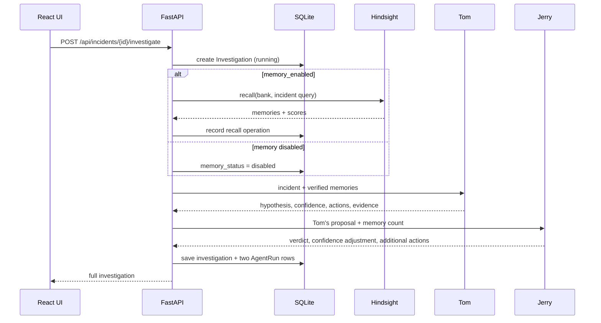

# RecallOps AI — Architecture

## System shape

RecallOps is a three-tier local application:

```text
React/Vite UI  ──HTTP──▶  FastAPI  ──SQLAlchemy──▶  SQLite
                              │
                              ├──Hindsight SDK──▶  Hindsight server ──▶ PostgreSQL volume
                              │
                              └──OpenAI-compatible SDK──▶ Groq (optional)
```

The frontend never talks to Hindsight or Groq directly. It only consumes the backend API, so
credentials stay server-side and every memory operation is auditable.

## Backend layers

| Layer | Files | Responsibility |
|---|---|---|
| Configuration | `config.py` | Environment settings, placeholder detection, feature flags |
| Persistence | `database.py`, `models.py` | SQLAlchemy engine, schema, relationships |
| Contracts | `schemas.py` | Pydantic request/response models |
| API | `routers/` | Incident, investigation, memory, agent and analytics endpoints |
| Memory | `services/hindsight_service.py` | Real retain/recall/reflect and operation ledger |
| Reasoning | `services/investigation_service.py` | Tom/Jerry roles, fallback logic, ON/OFF comparison |
| Model access | `services/llm_service.py` | Groq chat and JSON completion with explicit failure |
| Collaboration | `services/band_service.py` | Verify pre-existing Band agent identities |
| Backfill | `services/memory_sync.py` | Throttled retention of resolved incidents |
| Demo corpus | `services/seed.py` | Eight idempotent synthetic incidents |

## Data model

```text
incidents
  id, incident_code, title, service, severity, status, description,
  symptoms[], started_at, resolved_at, root_cause, resolution_summary,
  resolution_steps[], memory_retained, is_synthetic, timestamps
      │
      ├──< investigations
      │      id, incident_id, status, memory_enabled, memory_status,
      │      summary, root_cause_hypothesis, confidence,
      │      recommended_actions[], evidence[], recalled_memories[],
      │      llm_provider, timestamps
      │          │
      │          └──< agent_runs
      │                 id, investigation_id, agent_name, role, provider,
      │                 status, input_summary, output, latency_ms, error
      │
      └──< memory_operations
             id, incident_id, investigation_id, operation, bank_id,
             status, request_payload, response_payload, latency_ms, error
```

`memory_operations` is append-only from the application's perspective. Failures are retained so a
reviewer can see exactly what happened, including provider quota errors.

## Investigation flow



### Memory-ON vs memory-OFF

`POST /api/incidents/{id}/compare` runs both modes sequentially and returns:

- `memory_off` investigation
- `memory_on` investigation
- `delta_confidence`
- `memories_used`

The comparison is measured from real runs. There is no hard-coded benchmark lift.

### Deterministic fallback

When the app LLM is not configured or rate-limited, Tom/Jerry use deterministic rules keyed on
incident text and recalled memory. The provider label is always `local-deterministic`; the memory
status remains separate (`used`, `empty`, `failed`, `unavailable`, `disabled`).

This separation is deliberate: an investigation can be memory-backed even when the language model
is unavailable, and the UI will say exactly that.

## Agent collaboration

Tom and Jerry are not two prompts hidden behind one call. Each run produces a separate `agent_runs`
row with its own role, provider, input summary, structured output and latency.

- **Tom** — investigator. Produces the root-cause hypothesis, confidence, prioritized actions and
  evidence.
- **Jerry** — critical reviewer. Produces a verdict, confidence adjustment, concerns and additional
  actions.

When Band credentials are absent, `BandService` reports `configured=false` and the investigation
provider is `local-deterministic`. When credentials are present, it calls the Band REST identity
endpoint for each configured key and verifies the existing agents. It never creates agents.

## Hindsight concurrency fix

The Hindsight Python SDK wraps an `aiohttp` session bound to the event loop of the thread that
created it. A single long-lived client reused across FastAPI's worker threads produced:

```text
RuntimeError: Timeout context manager should be used inside a task
```

The fix is a fresh client per operation, closed in a `finally` block. This is safe for the
application's request rates and avoids cross-thread event-loop reuse. The regression is covered by
the memory-ON integration test through a fake memory boundary and was verified against the live
server.

## Failure handling

| Failure | Behaviour |
|---|---|
| Hindsight URL missing | memory status `unavailable`; investigation still completes without memory |
| Hindsight recall fails | memory status `failed`; error recorded; deterministic or LLM analysis continues |
| Hindsight retain fails | operation recorded as `failed`; incident stays `memory_retained=false` |
| Groq rate limit | model call fails over to `openai/gpt-oss-20b`, then to deterministic fallback |
| Band missing | explicit `local-fallback`; no fake "live" status |
| Reflect quota exhausted | exact provider error stored in the ledger and surfaced in the UI |

## Security and secret handling

- `.env` is gitignored; `.env.example` contains placeholders only.
- The API returns booleans and non-secret configuration, never key values.
- The Hindsight API key is optional for a local Docker server.
- No runtime credential extraction from editor/CLI auth stores.
- The submission bundle excludes `.env`, `.venv`, `node_modules`, virtual environments and logs.

## Frontend

- React 19 + TypeScript + Vite.
- Tailwind CSS 4 with a dark charcoal/navy command-center palette.
- Lucide icons and Recharts for failure concentration and memory impact.
- `api.ts` centralises typed calls and error handling.
- Every page has a loading and retry state.
- Synthetic data is labelled in the top bar, incident rows and memory payloads.
- Provider badges distinguish `groq:*`, `local-deterministic` and `band`.

## Deployment assumptions

This is a local-first demo. There is no authentication, multi-tenancy or production hardening.
SQLite and the local Hindsight container are intentional choices for reproducibility. A production
deployment would add auth, Postgres, queueing, rate-limit budgeting and per-tenant memory banks.
