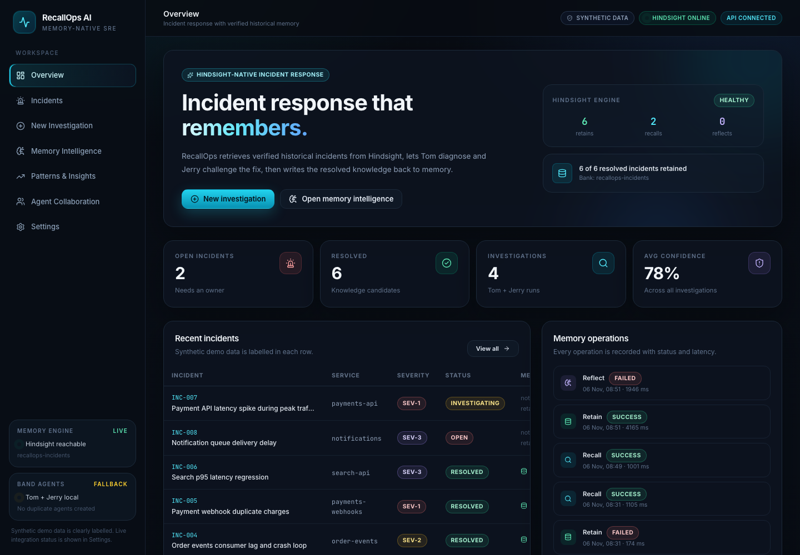
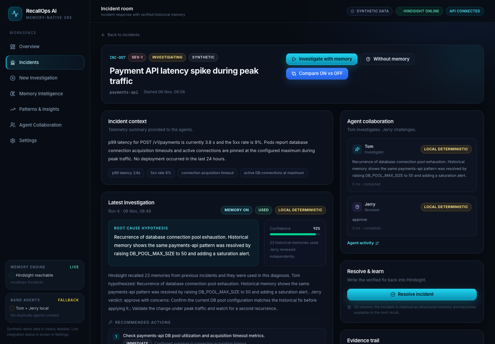
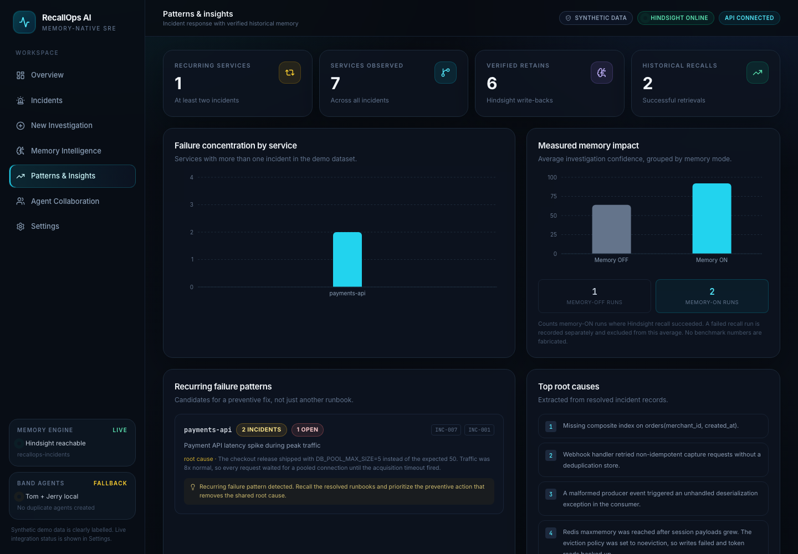

# Building an Incident Response Agent That Actually Remembers

**A memory-native SRE workflow with Hindsight, FastAPI, and a measured memory-on vs memory-off comparison.**



Most incident-response tools are very good at the current incident. They collect symptoms, page the
on-call, open a timeline and then close the ticket. The knowledge that made the fix possible often
disappears into a Slack thread, a postmortem nobody reopens, or the memory of the one engineer who
happened to be awake.

We invest heavily in observability, but the resolution itself is usually the least searchable
artifact we produce. The next incident starts with better dashboards and worse memory.

RecallOps is an attempt to reverse that. It is an incident-response workspace where resolved
incidents become structured memory, and new incidents are diagnosed against that memory. The
important word is *structured*. This is not a chat sidebar that summarises old tickets. The memory
layer is the system of record, and the product is designed to show when it helped and when it did
not.

## Why chat history is not memory

A generic assistant can be told to "remember previous incidents." In practice, that usually means
stuffing a few summaries into a prompt and hoping the model picks the relevant one. It is hard to
audit, hard to evaluate and impossible to compare across runs.

For incident response, memory needs four properties:

1. **Durable write-back.** A resolved incident must become a record with a root cause, a resolution
   and a runbook.
2. **Retrieval with evidence.** A new incident must retrieve actual prior records, with source and
   score, not a paraphrased summary.
3. **Separation from reasoning.** The model that diagnoses an incident should be able to say
   "memory was unavailable" without pretending it had context.
4. **Measurable impact.** The product should be able to run the same incident with memory ON and
   memory OFF and compare the results.

Those requirements shaped the architecture more than any UI decision.

## Designing around Hindsight

RecallOps uses Hindsight as the operational memory service. The backend is FastAPI with SQLite for
incident state, investigations, agent runs and an append-only memory-operation ledger. The frontend
is React, TypeScript, Vite and Tailwind.

The flow is deliberately simple:

```text
React UI → FastAPI → Hindsight retain / recall / reflect
                    → SQLite incident + investigation + agent-run records
```

The frontend never talks to Hindsight directly. Credentials stay server-side, and every memory call
is recorded with status, latency and error text. That ledger turned out to be one of the most useful
parts of the product: it makes the memory layer observable.

On startup, the backend ensures the `recallops-incidents` bank exists without recreating it, then
backfills resolved incidents in the background with a throttle so free-tier extraction is not
hammered by a burst of requests.

## The memory record

A memory is only as useful as the text you retain. The retain payload includes the incident code,
service, severity, symptoms, description, root cause, resolution summary and resolution steps. It
also carries metadata and tags for filtering:

```python
client.retain(
    bank_id="recallops-incidents",
    content=content,
    context=f"{incident.incident_code} {incident.service} {incident.severity}",
    metadata={
        "incident_code": incident.incident_code,
        "service": incident.service,
        "severity": incident.severity,
        "synthetic": str(incident.is_synthetic).lower(),
    },
    tags=["incident", incident.service.lower().replace(" ", "-")],
)
```

The content is readable enough for a human and structured enough for retrieval. A dense JSON blob
is easy to generate and hard to retrieve; a vague paragraph is easy to read and useless for matching
a specific failure mode.

The demo corpus has eight synthetic incidents. `INC-001` is a payments-api latency spike caused by
`DB_POOL_MAX_SIZE=5` instead of 50. The fix was to raise the pool size and add a saturation alert.
That incident is the memory that later saves the day.

## Retrieval as evidence

When a new incident arrives, the backend builds a query from the title, service, symptoms and
description, then calls Hindsight:

```python
response = client.recall(
    bank_id="recallops-incidents",
    query=query,
    max_tokens=2048,
    budget="low",
)
```

The response is normalised into records with text, metadata, tags and scores. The investigation
stores the retrieved memories and adds the top five as evidence entries with `source="hindsight"`.
The UI shows the count and the actual text. A reviewer can inspect what the model saw instead of
trusting a summary.

In an incident review, "the agent used 23 memories, and here are the five that mattered" is a
stronger claim than "the agent remembered something similar."

## The agent split: Tom and Jerry

RecallOps uses two explicit roles. Tom is the investigator. He receives the incident and the
verified memories, then produces a root-cause hypothesis, a confidence score, prioritized actions
and evidence. Jerry is the critical reviewer. He receives Tom's proposal and the memory count, then
produces a verdict, a confidence adjustment, concerns and additional actions.

The split is not cosmetic. Each role gets its own prompt, structured output and `agent_runs` row,
with separate provider badges. When Band credentials are present, the service verifies pre-existing
agent identities through the Band REST API. When they are absent, runs are labelled
`local-deterministic` or `local-fallback`. A local fallback is never presented as a live Band call.

Agent demos often collapse every failure into a confident narrative. For an operational tool, that
is worse than useless. An on-call engineer needs to know whether a recommendation came from verified
memory, a language model or a deterministic rulebook.

## Measuring the difference

The most important screen is not the chat. It is the comparison.

RecallOps can run the same incident twice: once with memory disabled and once with memory enabled.
For `INC-007`, a payments-api latency spike with the same pool-exhaustion symptoms as `INC-001`, the
results were:

| Mode | Memories | Confidence | Root cause |
|---|---:|---:|---|
| Memory OFF | 0 | 64% | "Database connection pool exhaustion is the leading hypothesis." |
| Memory ON | 23 | 92% | "Recurrence of database connection pool exhaustion. Historical memory shows the same payments-api pattern was resolved by raising `DB_POOL_MAX_SIZE` to 50." |

The measured difference is **+28 percentage points**. The memory-ON run cites the prior incident as
evidence and recommends the proven fix. The memory-OFF run reaches a plausible hypothesis but has
no historical proof.

That is the product thesis in one table: memory does not just make the answer longer. It changes
what the system can justify.

## The bug that made the integration real

The first version of the Hindsight service used a single long-lived client. Retain worked from the
background sync thread, but recall failed inside FastAPI request threads:

```text
RuntimeError: Timeout context manager should be used inside a task
```

The SDK wraps an `aiohttp` session bound to the event loop of the thread that created it. Reusing
that client across worker threads was the bug. The fix was to create a fresh client per operation
and close it in a `finally` block:

```python
def _new_client(self):
    if not self.settings.hindsight_configured:
        return None
    return Hindsight(
        base_url=self.settings.hindsight_api_url,
        api_key=self.settings.hindsight_api_key,
        timeout=self.settings.hindsight_timeout,
        max_attempts=1,
    )
```

After that change, recall returned 18–23 memories and the memory-ON run reached 92% confidence. A
memory integration is a systems problem, not a prompt problem. Threading, event loops, retries and
quotas all show up in the incident room.

## Failure handling and honesty

Hindsight retain performs LLM-based fact extraction, so it consumes tokens. On a free tier, quota
matters. During verification, the 120b model hit its daily limit; switching to `openai/gpt-oss-20b`
and `on_demand` service tier fixed the retain path. Later, reflect hit a provider quota error. The
operation was recorded as failed and surfaced in the ledger.

The product does not hide that. The Memory Intelligence page shows the exact error, and the README
states that reflect was not verified successfully. Retain and recall were verified independently.
That distinction is more valuable than a green checkmark that cannot be defended.

The same principle applies to the app-level LLM. Without a valid Groq key, Tom and Jerry use a
deterministic fallback. The provider badge says so. The investigation still works, and the memory
comparison is still measurable. The fallback is not a failure of the demo; it is a deliberate
degradation path.

## Lessons

**Memory needs a schema.** Retained text should read like an incident record, not a log dump.

**Retrieval needs a ledger.** Record every call, including failures. It makes debugging possible and
prevents accidental exaggeration.

**Separate memory from reasoning.** A memory-backed deterministic run is legitimate. Do not couple
memory status to the model provider.

**Measure the delta.** Run the same incident both ways and show the numbers.

**Design for quota.** Throttle backfills, retry once, preserve the error and let the operator decide
when to retry.

## What's next

The current build is local-first and intentionally small: SQLite, a local Hindsight container and a
single memory bank. Next steps are production concerns: per-team banks, authentication, Postgres, a
retention queue, cost-aware retrieval budgets and an evaluation set that tracks memory-assisted
diagnosis quality over time.

The core idea is already testable: incident response should compound. Every resolved incident should
make the next one cheaper to diagnose. Hindsight gives that idea a real memory layer.




